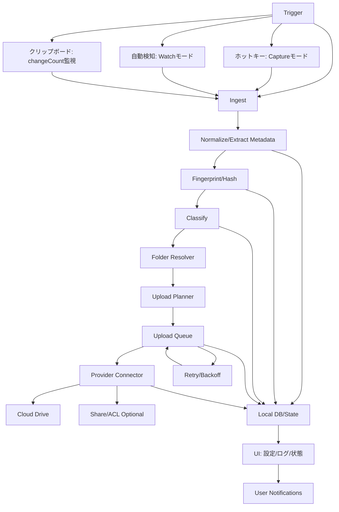
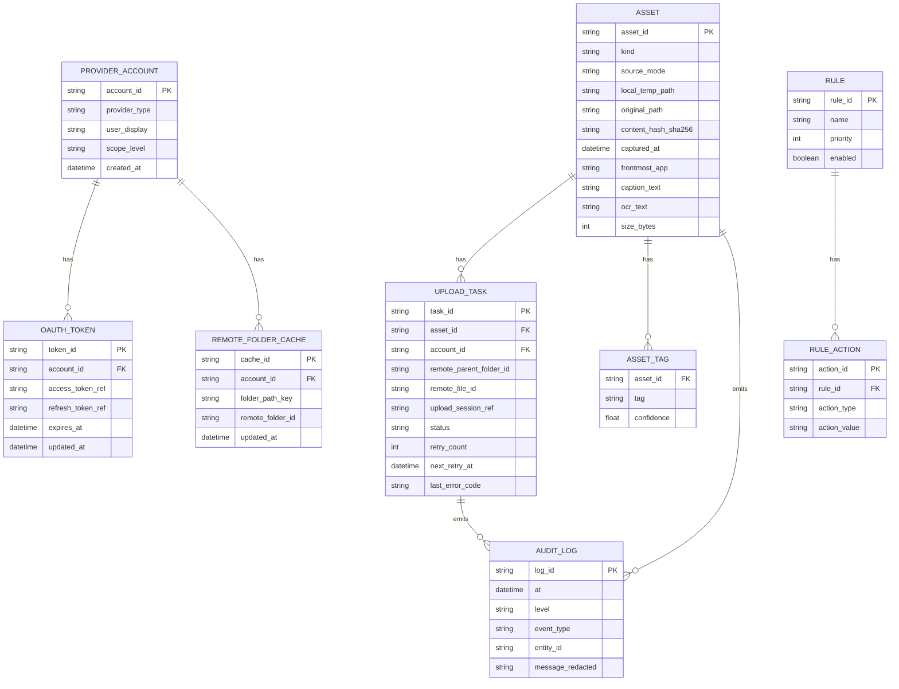

# Macスクリーンショット等の自動クラウド保存・分類システム 要件定義・システム設計・技術仕様書

## エグゼクティブサマリ

本書は、macOS上で生成されるスクリーンショット／画面録画／クリップボード画像／動画／キャプション（テキスト）を、ローカル保存（例：デスクトップに残存）できる限り回避し、指定クラウドドライブへ自動で保存・分類・フォルダ自動生成するシステムの要件定義・システム設計・技術仕様を統合的に提示する。macOS標準のスクリーンショット機能は、保存先をスクリーンショットアプリ（Shift+Command+5）の「オプション」で変更可能であり、クリップボード保存も可能であるため、ユーザー導線とシステム導線を組み合わせた実現が現実的である。citeturn21view3

設計方針は「Captureモード（自前キャプチャ）」と「Watchモード（保存先監視）」の二系統を中核に置く。CaptureモードではアプリがショートカットやUIから直接キャプチャを取得し、アプリのコンテナ配下の一時領域（またはメモリ）→分類→クラウドへアップロード→一時領域削除、の順でローカル残存を最小化する。Watchモードでは、ユーザーがmacOS標準スクリーンショットの保存先を「監視フォルダ」に変更し、ファイルシステムイベント監視により作成直後に取り込み・アップロード・（構成に応じて）ローカル移動/削除を実行する。ファイルシステム監視にはFSEventsがディレクトリ階層変更の通知を提供する。citeturn22view2

クラウド連携は、(a) 各クラウドの公式API（OAuth 2.0 + PKCE推奨）で直接アップロードする方式、(b) 各クラウドの同期クライアントが提供するローカル同期フォルダへ書き込む方式（フォールバック）を併設する。ネイティブアプリのOAuthでは外部ユーザーエージェント（通常はシステムブラウザ）使用がベストプラクティスであり、PKCEは公開クライアントに対する認可コード横取り攻撃対策として標準化されている。citeturn11search4turn11search8

アップロードは「再開可能（resumable）」を基本要件とする。Google Drive APIは再開可能アップロードでセッションURIを発行し、セッションURIが1週間で失効する。citeturn20view1　OneDrive（Microsoft Graph）はuploadSessionに有効期限（expirationDateTime）があり、フラグメント送信で期限延長され、再開のためのnextExpectedRangesも提供する。citeturn28view1　Dropboxはアップロードセッションを最大7日利用でき、分割アップロードと完了コミットを提供し、最大ファイルサイズ等の制約も明示される。citeturn14view0

自動分類は「メタデータ（時刻・種別・ファイル名等）＋OCR（テキスト抽出）＋ユーザールール」を基本線に、必要に応じて画像分類（Vision + Core ML）を加えたハイブリッド方式を推奨する。OCRはVisionのテキスト認識リクエスト（VNRecognizeTextRequest）で実装できる。citeturn1search25　画像分類はVNCoreMLRequest（Core MLモデルをVisionリクエストとして実行）で実装でき、Create MLで画像分類モデル作成も可能である。citeturn15search0turn15search2

セキュリティは「最小権限」「トークンはKeychain格納」「通信はTLS」「ログの個人情報最小化」を基本とする。Keychainは短い秘密情報（パスワード・鍵・ログイントークン等）の格納に適した機構としてAppleが提供している。citeturn11search2turn11search3

配布は「Mac App Store配布（サンドボックス準拠）」と「社内配布（Developer ID署名＋Notarization）」を想定する。社外配布の場合、Developer ID署名とNotarizationによりGatekeeper環境での信頼性が向上する。citeturn17search3turn17search0turn17search1

## 前提と考慮すべき属性／次元

### 対象OS／バージョン

未指定のため「macOS最新＋過去2世代」を、2026-03-09時点の公式“latest versions”に基づき **macOS Tahoe 26.3.1／macOS Sequoia 15.7.4／macOS Sonoma 14.8.4** を対象とする。citeturn29view0turn3search0turn3search1  
ただしOS機能差（例：スクリーンショットフォーマット選択等）は機種とOSに依存するため、取り込みパイプラインは「入力形式を正規化して以後は同一処理」とする。macOS Tahoe 26以降の一部対応モデルではスクリーンショットのキャプチャフォーマット（例：PNG/HEIF）が選択可能である。citeturn21view3

### 対象ファイル種別

対象は以下とし、すべて「取り込み→正規化→分類→クラウド保存」のフローに統合する。

* スクリーンショット（PNG/HEIF 等）
* 画面録画（通常mov等の動画）
* クリップボード画像（画像データ、または画像ファイルとして一時エクスポート）
* 動画（ユーザーが指定した動画、または取り込み対象フォルダに生成された動画）
* キャプション／テキスト（ユーザー入力テキスト、OCR抽出テキスト、またはサイドカーのテキストファイル）

macOS標準のスクリーンショット機能はデスクトップ保存・保存先変更・クリップボード保存の双方をサポートするため、運用設計で「Watchモードに適した保存先の統制」「Captureモードでの直接取り込み」を選択できる。citeturn21view3  
画面録画もmacOSのスクリーンショットアプリ（Shift+Command+5）で行える。citeturn4search12turn4search1

### トリガー方式

要求に基づき、以下をすべて設計対象とする。

* 自動検知：監視フォルダ（Watchフォルダ）に作成された新規ファイルをFSEvents等で検知し取り込み。FSEventsはディレクトリ階層の変更通知を提供する。citeturn22view2
* ホットキー：グローバルショートカットにより「キャプチャ」「クリップボードをアップロード」「キャプチャ＋キャプション入力」等を起動（Captureモード）。
* 保存時フック：厳密なOSレベル“フック”はApp Store配布では制約が大きいため、本仕様では **(a) Watchフォルダ監視** と **(b) Captureモード** を実装上の一次手段とする。サードパーティアプリの“保存イベント”を強制的に横取りする方式は、System Extension/Endpoint Security等の採用が必要になる可能性があり、配布形態と審査の観点でオプション扱いとする（後述）。Endpoint Securityはシステムイベント監視のためのC APIを提供し、事後通知やインフライト制御を選択できる。citeturn16search8turn16search2

### 保存先候補（クラウドドライブ）

クラウド候補は以下を基本とし、拡張可能なコネクタ方式（Provider plugin）で設計する。

* Google Drive（公式API）
* OneDrive（Microsoft Graph／OneDrive API）
* Dropbox（公式API）
* iCloud Drive（主にファイルベース同期：iCloudコンテナ／ユーザー選択フォルダ）

なお、iCloudはGoogle/OneDrive/Dropboxのような一般公開の“iCloud Drive REST API”が存在しないため、AppleのiCloudドキュメントストレージ／ファイル協調（NSFileCoordinator/NSFilePresenter）による統合、またはユーザーが選択したiCloud Drive配下フォルダへの書き込みを主経路とする。iCloudドキュメントではファイル協調が必須である（設計ガイド上の要件）。citeturn26view2turn9search2turn9search3

### 認証方式

* OAuth 2.0（認可コード＋PKCE）を優先（Google/Microsoft/Dropbox）。
  * ネイティブアプリは外部ユーザーエージェント（ブラウザ）利用が推奨される。citeturn11search4
  * PKCEは公開クライアント向けの防御策として標準化。citeturn11search8
* Apple ID：iCloudコンテナ／iCloud DriveはOSレベルのApple IDログインに依存する（アプリ側はiCloud機能の有効化とコンテナ設定等）。citeturn26view2
* トークン：アクセストークン／リフレッシュトークン等はKeychainに保存する。Keychainは秘密情報の格納先として推奨される。citeturn11search3turn11search2

### 同期方式

* リアルタイム：取り込み直後にアップロード開始（ネットワーク可用時）。
* バッチ：一定時間ごと／回線条件（Wi‑Fiのみ等）でまとめてアップロード。
* オフラインキュー：ネットワーク不通やレート制限時にキューへ積み、復帰後に再開（期限付きセッションの扱いに注意）。

アップロードセッションには期限があるため、「セッションID（uploadUrl/Location等）の保持」と「期限切れ時の再作成」を仕様化する。Google Driveの再開可能セッションURIは1週間で失効する。citeturn20view1　OneDriveのuploadSessionはexpirationDateTimeを持ち、フラグメントで延長される。citeturn28view1　Dropboxのアップロードセッションは最大7日利用できる。citeturn14view0

### 分類アルゴリズム、フォルダ命名／生成、重複、エラー、プライバシー、権限、運用

本書の後続章で、以下を必須検討次元として詳細化する。

* 分類アルゴリズム：メタデータ、OCR、画像分類、ユーザールール、ML
* フォルダ命名規則と自動生成ルール
* 重複検出（ハッシュ・メタデータ）とバージョン管理（命名、クラウド側の競合動作）
* エラー処理とリトライ（429/5xx/セッション期限など）
* プライバシーと暗号化（Keychain、転送、ログ）
* 権限と共有設定（共有リンク作成／ACL）
* UI/UX（設定、ログ、通知）
* 運用（監視、ログ収集、障害対応）
* テスト計画、概算見積り、依存ライブラリ、実装技術、セキュリティリスク、デプロイ

## 要件定義

### 機能要件一覧

| ID | 要件 | 詳細（合否基準） |
|---|---|---|
| FR-01 | 取り込み対象の統合 | スクリーンショット／画面録画／クリップボード画像／動画／キャプション（テキスト）を統一“Asset”として扱う。各種別を判定し、メタデータを共通化する（作成日時、種別、拡張子/UTI、サイズ等）。UTIは例としてQuickTime movieが `com.apple.quicktime-movie` である。citeturn15search3turn15search23 |
| FR-02 | トリガー（Watchモード） | Watchフォルダに生成されたファイルを自動検知し取り込み。FSEventsによりディレクトリ階層変更を検知できる。citeturn22view2 |
| FR-03 | トリガー（Captureモード） | グローバルホットキーでキャプチャ取得／クリップボード取り込みを実行。画面キャプチャは高性能スクリーンキャプチャのためのScreenCaptureKitを利用可能。citeturn0search0turn0search20 |
| FR-04 | スクリーンショット保存先の統制支援 | 初期セットアップで、macOS標準スクリーンショットアプリ（Shift+Command+5）の「保存先を選択」によりWatchフォルダへ向ける操作をガイドする。citeturn21view3turn4search1 |
| FR-05 | クリップボード監視 | NSPasteboardのchangeCount等に基づき変更を検出し、画像/テキストを取り込める（ポーリング含む）。changeCountは所有者変更で増加する。citeturn6search0turn6search6 |
| FR-06 | 自動分類 | メタデータ・OCR・画像分類・ユーザールールによりラベル/カテゴリを付与し、フォルダパス生成に利用する。OCRはVisionのVNRecognizeTextRequestで実行可能。citeturn1search25turn1search2 |
| FR-07 | フォルダ自動生成 | クラウド側で階層フォルダを自動作成し、目的フォルダに格納する。Google Driveではfolder作成とparents指定が可能。citeturn7search2turn7search10 |
| FR-08 | アップロード（再開可能） | 大容量動画を含め、再開可能アップロード・分割送信・再開を提供。Google Driveはresumable upload（セッションURI、308等）を提供。citeturn20view1 |
| FR-09 | OneDrive大容量アップロード | Microsoft GraphのcreateUploadSession（uploadUrl、expirationDateTime、nextExpectedRanges）に対応。citeturn28view1 |
| FR-10 | Dropbox大容量アップロード | Dropbox upload session（start/append/finish）に対応し、セッション最大7日等の制約を遵守。citeturn14view0 |
| FR-11 | iCloud Drive連携 | iCloudドキュメントストレージはファイル協調（NSFileCoordinator/NSFilePresenter）を前提に設計し、ユーザー選択フォルダ方式も提供する。iCloudドキュメントではファイル協調が必須。citeturn26view2turn9search2turn9search3 |
| FR-12 | 重複検出 | ローカルハッシュ（SHA-256など）＋クラウド側メタデータハッシュを用いて重複を検出し、二重アップロードを回避する。SHA256はCryptoKitで提供される。citeturn10search0turn10search12 |
| FR-13 | クラウド側ハッシュ参照 | Google Driveはファイルのmd5Checksumを提供（バイナリのみ）。OneDriveはhashes（quickXorHash/sha1等）を提供。Dropboxはcontent_hashを提供。citeturn19search0turn19search2turn20view2turn19search3 |
| FR-14 | バージョン管理 | 名前衝突時は「rename」「overwrite」「version update」をポリシーで選択可能にする。OneDrive upload session作成例で conflictBehavior=rename が示される。citeturn28view1 |
| FR-15 | エラー処理・リトライ | 429/5xx/ネットワーク断/セッション期限等を分類し、Retry-After尊重＋指数バックオフ＋上限回数。Microsoft Graphは429でRetry-After利用を推奨。DropboxもRetry-Afterとバックオフを推奨。citeturn27search0turn27search10turn27search18 |
| FR-16 | 共有設定 | 既定は非共有（private）とし、必要に応じて共有リンク作成や権限付与を実装。Google Driveはpermissions.create、OneDriveはcreateLink、Dropboxはcreate_shared_link_with_settingsを案内。citeturn18search1turn18search2turn18search3 |
| FR-17 | UI/UX | メニューバー常駐＋設定画面（接続先、分類ルール、フォルダ規則、ログ閲覧、手動再試行、停止/再開）。通知はユーザー許可後に利用（UNUserNotificationCenter requestAuthorization）。citeturn16search0turn16search9 |
| FR-18 | 監査ログ | 取り込み・分類・アップロード・共有操作の監査ログ（最小個人情報）を保持し、障害解析に利用。Unified LoggingはOSLogで読み取り可能。citeturn16search1turn16search4 |

### 非機能要件一覧

| 区分 | 要件 | 指標例 |
|---|---|---|
| セキュリティ | トークン秘匿 | リフレッシュトークン等はKeychainに保存（Keychainは秘密情報格納に適する）。citeturn11search3turn11search2 |
| セキュリティ | OAuth実装適正 | 外部ブラウザ＋認可コード＋PKCE（RFC 8252/RFC 7636準拠）を既定とする。citeturn11search4turn11search8 |
| プライバシー | OCR/分類の制御 | OCR/画像分類は既定OFFまたは最小権限（ユーザー同意）で、テキスト抽出結果の保存範囲を設定可能にする（クラウドへ送る/ローカルDBのみ等）。VNRecognizeTextRequestでOCR可能。citeturn1search25 |
| 信頼性 | オフライン耐性 | オフラインキュー＋再開可能アップロード。セッション期限（Google 1週、Dropbox 7日、OneDrive expirationDateTime）を考慮して再作成する。citeturn20view1turn14view0turn28view1 |
| 性能 | 体感遅延 | スクリーンショット（数MB）で「取り込み→分類→アップロード開始」まで数秒以内（ネットワーク依存）。大容量はバックグラウンド化。Background URLSessionは大容量転送に有効とされる。citeturn10search23turn10search3 |
| 可用性 | リトライ方針 | 429はRetry-After、5xxはバックオフ、期限切れはセッション再作成等。Google Driveのresumableは5xx/403 rate limit等の扱いをガイド。citeturn20view1turn27search5turn27search0 |
| 互換性 | OSサポート | macOS Tahoe 26.x / Sequoia 15.x / Sonoma 14.x で同等機能。citeturn29view0 |
| 配布 | App Store／社内 | App Store向けはサンドボックス・申請要件を順守。社内配布はDeveloper ID署名＋Notarization。citeturn17search4turn17search3turn17search0 |
| 保守性 | コネクタ分離 | クラウドごとの差分（認証・アップロード・共有）をProviderコネクタとして抽象化し、追加実装を容易にする。 |
| 監視性 | ログ/メトリクス | OSLogに加え、アプリ内に直近N件のイベント閲覧・エクスポート機能。OSLogは統合ロギングを扱う。citeturn16search1turn16search4 |

## システム設計

### 全体アーキテクチャ概要

本システムは「常駐エージェント（取り込み・キュー・同期）」「UI（設定・可視化）」「クラウドコネクタ（Provider別）」の三層で構成する。WatchモードではFSEvents等でWatchフォルダの変化を検出する。citeturn22view2  
App Store配布を想定する場合、ユーザーが明示的に選択したフォルダへのアクセス（User Selected File）と、再起動後もアクセス継続するためのSecurity-Scoped Bookmarkが重要となる。macOSのApp Sandboxでは、機能ごとにエンタイトルメントを付与し、NSOpenPanel/NSSavePanelでユーザーが選択した範囲へアクセスできる。citeturn25view1

### アーキテクチャ図（フロー）

フロー上、キューと状態管理（Local DB）が中心的役割を持つ。再開可能アップロードは「セッション（uploadUrl/Location）」「次に送るバイト範囲」「期限」を状態として持つ必要がある（Googleは1週間で失効、OneDriveはexpirationDateTime、Dropboxは最大7日）。citeturn20view1turn28view1turn14view0  
通知はユーザー許可が必要であり、UNUserNotificationCenter.requestAuthorizationで許可取得する。citeturn16search0turn16search9

### アーキテクチャ図（ER：データモデル）

本ERは「クラウド差分をUPLOAD_TASKとPROVIDER_ACCOUNTに閉じ込める」ことを狙いとしている。クラウド側の“フォルダID”は多くの場合パスではなくIDで参照されるため、フォルダ階層の自動生成は「論理パス→リモートID」のキャッシュが必須になる（例：Google Driveのparents指定、OneDrive special/approot等）。citeturn7search2turn8search2

## 技術仕様

### サンドボックス前提のファイルアクセス方針

App Store配布を想定すると、アプリはApp Sandbox下で動作し、必要な機能（ファイルアクセス、ネットワーク等）をエンタイトルメントで明示する。AppleのEntitlement Key Referenceでは、App Sandbox有効化（com.apple.security.app-sandbox）と、ユーザーがダイアログで選択したファイルへのread/write権限（com.apple.security.files.user-selected.read-write）等が整理されている。citeturn25view1turn24search2

Watchモードで「任意ディレクトリを常時監視」する場合、監視対象はユーザーにNSOpenPanel等で選択させ、以後の起動でもアクセスするためにSecurity-Scoped Bookmark（app-scope）を利用する。エンタイトルメントの概念と、違反がsandboxdにログされる点が文書化されている。citeturn25view1

### 取り込み（Ingest）仕様

#### Watchモード（自動検知）

1. ユーザーが「Watchフォルダ」を選択（UIウィザード）。
2. macOS標準スクリーンショットの保存先をWatchフォルダに設定するようガイド。スクリーンショットアプリ（Shift+Command+5）には保存先選択があり、デフォルト保存場所は変更できる。citeturn21view3turn4search1
3. Watchフォルダ配下でファイル生成をFSEvents等で検知し、生成完了（サイズ安定・ファイルロック解除）を待って取り込みへ進む。FSEventsはディレクトリ階層変更通知を提供する。citeturn22view2

**ローカル保存回避の現実的な限界**：このモードでは、OSが一度ファイルをローカルに書き出すため「短時間はローカルに存在」する。よって「ローカル残存時間の短縮」「直後に移動/削除」「ゴミ箱へ入れない（必要なら完全削除）」等の運用オプションを提供し、要求水準（完全不残 vs 最小化）を要件として明示する。

#### Captureモード（ホットキー／UI起点）

* スクリーンキャプチャ：ScreenCaptureKitを用いてアプリが画面コンテンツを取得し、直接クラウドへ送る（途中は一時領域）。ScreenCaptureKitは高性能な画面/音声キャプチャを提供する。citeturn0search0turn0search20
* 画面録画：ScreenCaptureKitでストリームを受け取り、エンコードしつつ一時ファイルに出力し、チャンクアップロードする（大容量転送のため再開可能アップロードを必須にする）。
* キャプション：キャプチャ直後にユーザー入力UI（例：小型ポップオーバー）を出し、テキストをAsset.caption_textとして保存して分類に使う。

このモードは「OS標準ショートカットを置き換える」運用になるため、導入組織ではショートカット周知・教育を含めた運用設計が必要になる。

#### クリップボード取り込み

NSPasteboardのchangeCountは所有者変更で増加し、変更検知の基礎になる。citeturn6search0turn6search6  
ただしmacOS標準で“イベント通知”として提供される形ではないことが多いため、実装は「短周期ポーリング＋低負荷化（省電力）」または「手動（ホットキー）取り込み」を主要パスとする（ポーリング周期はユーザー設定可能）。

### クラウドコネクタ仕様

#### 共通インターフェース（Provider Connector）

各クラウドに対し、以下の抽象操作を提供する。

* `Authenticate()`：認可開始（外部ブラウザ）→リダイレクト受信→トークン取得→Keychain格納
* `EnsureFolder(pathComponents)`：必要フォルダの存在確認（キャッシュ）→なければ作成
* `UploadResumable(asset, remoteFolderId)`：再開可能アップロード開始→分割送信→完了
* `SetSharing(remoteFileId, policy)`：共有/権限（任意）
* `GetRemoteHashes(remoteFileId)`：重複検出・検証用（任意）

OAuth 2.0ネイティブアプリでは外部ユーザーエージェント利用が推奨であり、ループバックリダイレクト等が認められる。citeturn11search4turn7search3

#### Google Drive（API仕様要点）

* OAuth：Googleのネイティブアプリ向けOAuth 2.0手順に準拠。citeturn7search0turn7search5  
* スコープ：最小権限（例：drive.file等）を優先し、必要に応じて拡張する。スコープ選択ガイドが提供される。citeturn7search1turn7search4  
* フォルダ：foldersガイドに従い、files.createでparentsにフォルダIDを指定して作成/配置。citeturn7search2turn7search10  
* アップロード：resumable uploadはセッションURIをLocationヘッダで受け取り、1週間で失効する。中断時は308等を用いて再開し、4xxはセッション再取得が必要となる。citeturn20view1  
* 共有：permissions.createで権限作成し、type/roleで共有主体と操作権限を表す。citeturn18search1turn18search0  
* 重複検出：filesリソースにはmd5Checksum（バイナリに適用）がある。citeturn19search0

#### OneDrive（Microsoft Graph）（API仕様要点）

* OAuth：Microsoft identity platformの認可コードフローに準拠し、macOS/iOS向けMSAL利用を基本とする。citeturn8search4turn8search1turn8search8  
* アプリ専用フォルダ：special/approot でアプリフォルダを取得し、初回アクセスで作成される（Apps/{AppName}）。citeturn8search2turn8search6  
* 大容量アップロード：createUploadSessionでuploadUrlとexpirationDateTimeを得て分割PUT。nextExpectedRangesで再開点を把握。PUT時にAuthorizationヘッダを含めない注意等が記載される。citeturn28view1  
* スロットリング：429時にRetry-Afterを尊重してバックオフすることが推奨される。citeturn27search0  
* 共有リンク：driveItem createLinkで共有リンクを作成できる。citeturn18search2  
* ハッシュ：hashesリソースでquickXorHash等が提供され、quickXorHashは個人/法人で利用可能性が高い旨が示される。citeturn19search4turn19search2

#### Dropbox（API仕様要点）

* OAuth：Dropbox OAuth Guideに従い、デスクトップ等でclient_secret秘匿が困難な場合はPKCEを推奨。短命アクセストークン＋refresh token（token_access_type=offline）も説明される。citeturn13view0turn1search5  
* 大容量アップロード：SDKドキュメント上、files_uploadは150MB以下推奨、upload sessionで分割し最大350GB、セッション最大7日などが示される。citeturn14view0  
* エラー処理：Dropbox Error Handling Guideは429時のRetry-Afterや指数バックオフを推奨し、性能ガイドでもRetry-Afterを必須としている。citeturn27search10turn27search18  
* 共有：DBX Sharing Guideは /sharing/create_shared_link_with_settings による共有リンク作成を示す。citeturn18search3  
* content_hash：DropboxはFileMetadataにcontent_hashを持ち、ローカル計算との一致で同一性検証が可能。citeturn20view2turn19search3

#### iCloud Drive（ファイルベース同期）（仕様要点）

iCloudは「iCloudドキュメントストレージ（アプリのiCloudコンテナ）」として設計するのが一次案である。iCloud Design Guideでは、iCloudドキュメントはファイル協調（NSFileCoordinator）とファイルプレゼンタ（NSFilePresenter）によって変更の整合性を担保し、これが必須である旨が明記される。citeturn26view2turn9search2turn9search3  
また、iCloud環境では競合（同名ファイルや同時更新）が発生し得るため、TN2336に従いNSFileVersion等を用いた競合解決・不要バージョンの削除を設計に含める。citeturn26view3turn10search5

実装としては次の二系統を用意する。

* **iCloudコンテナ（推奨）**：アプリのDocumentsフォルダをiCloud Driveに公開し、ユーザーがFinder等で閲覧可能にする（Appleのドキュメントモデルに沿う）。citeturn26view2turn26view3  
* **ユーザー選択フォルダ（フォールバック）**：ユーザーがiCloud Drive配下の任意フォルダを選択し、そこへ通常ファイル書き込み（ただしサンドボックス下ではSecurity-Scoped Bookmarkが必要になる）。この方式は「iCloud固有API非依存」だが、ユーザーがiCloud Driveを有効化していることが前提になる。

### フォルダ命名規則と自動生成ルール

#### 基本方針

フォルダ設計は「検索性」と「将来の移行/監査」を重視し、**生成ルールを明文化**してUIで可視化できることを必須とする。クラウドごとに“フォルダID/パス表現”が異なるため、論理パス（ルール）とリモートID（実体）をキャッシュする（ERのREMOTE_FOLDER_CACHE）。citeturn7search2turn8search2

#### 推奨フォルダ階層（例）

ルート：`{Root}/Captures/`

* 年：`YYYY/`
* 月：`YYYY-MM/`
* 種別：`Screenshots/` `ScreenRecordings/` `Clipboard/` `Videos/` `Text/`
* アプリ名：`{FrontmostApp}/`（Captureモードで確度高、Watchモードは不明の場合あり）
* 分類ラベル：`{Category}/`（例：Meeting、BugReport、Design、Private等）

例：  
`Captures/2026/2026-03/Screenshots/Safari/BugReport/`

#### ファイル命名規則（例）

`YYYY-MM-DD_HH-mm-ss_{Kind}_{AppOrUnknown}_{ShortHash}.{ext}`

* `{ShortHash}` はSHA-256先頭8〜12桁等（CryptoKitのSHA256で生成可能）。citeturn10search0turn10search12
* 文字種はクラウド間互換性のためASCII＋一部許容に正規化（`/ \ : * ? " < > |` 等は置換）。
* すでに同名が存在する場合は、クラウド側の“rename”ポリシー（例：OneDrive conflictBehavior rename）またはサフィックス付与（`_v2`等）で解決。citeturn28view1

### 重複検出とバージョン管理

#### 重複検出（Dedup）

重複判定は二段階にする。

1. **ローカル判定**：`(size_bytes, sha256)` の組で既存Assetと照合。sha256はCryptoKitで計算。citeturn10search0turn10search12  
2. **リモート判定**：プロバイダが提供するハッシュ／メタデータで照合可能なら追加検証。
   * Google Drive：md5Checksum（バイナリ）citeturn19search0  
   * OneDrive：hashes（quickXorHash/sha1等）citeturn19search2turn19search4  
   * Dropbox：content_hash（ローカル計算と一致確認可能）citeturn19search3turn20view2  

**動作ポリシー（設定可能）**  
A. 完全重複はアップロードせず「同一参照」としてログのみ残す  
B. 完全重複でも別フォルダに“コピー”として置く（監査要件向け）  
C. 重複でも必ず新規としてアップロード（最も単純だが容量増大）

#### バージョン管理

クラウドは一般にバージョン（リビジョン）概念を持つが、本システムは **“キャプチャは原則不変”** を前提に、デフォルトは「ファイル名ユニーク化」で運用する。iCloudは競合時に“bounced file name”が生成されるなど、競合解決振る舞いが領域（Documents vs data scope）で異なるため、iCloud側はTN2336に沿って競合の監視・不要バージョン削除を設計に含める。citeturn26view3  
OneDriveはupload session例でrename動作が示されるため、原則rename＋ユニーク命名で整合を取る。citeturn28view1

### エラー処理とリトライ仕様

#### エラー分類

* 認証系：401/invalid_grant 等 → トークン更新、失敗時は再認可
  * Google Driveはエラー解決ガイドでトークン更新や再OAuth誘導を示す。citeturn27search5
* スロットリング：429 → Retry-After尊重＋バックオフ
  * Microsoft Graphは429でRetry-Afterを使うことを推奨。citeturn27search0
  * Dropboxは429のRetry-Afterや指数バックオフを推奨。citeturn27search10turn27search18
* 一時障害：5xx/接続断 → 指数バックオフ＋再開可能アップロードの再開
  * Google Driveのresumable uploadガイドは5xx時のresume/retry、403 rate limit等の扱いを示す。citeturn20view1
* セッション期限：Googleは1週間失効、Dropboxは7日、OneDriveはexpirationDateTime超過 → セッション再作成して再アップロード
  * Google：1週間citeturn20view1
  * Dropbox：7日citeturn14view0
  * OneDrive：expirationDateTimeciteturn28view1
* ローカルI/O：ファイルロック、権限不足 → 再試行（短い）またはユーザー介入

#### リトライ・バックオフ

* 既定：指数バックオフ（例：1s, 2s, 4s, 8s…）＋ジッター＋最大回数（例：10回）  
* 429は原則Retry-Afterがあればそれに従う（Graph/Dropbox推奨）。citeturn27search0turn27search10  
* resumable uploadは「途中状態を問い合わせて次送信範囲を決定」する（GoogleはRangeヘッダ、OneDriveはnextExpectedRanges）。citeturn20view1turn28view1

### プライバシーと暗号化

* トークン保護：Keychain Servicesを使用し、アクセストークン/リフレッシュトークンを暗号化されたデータベースに格納する。citeturn11search2turn11search3  
* ハッシュ：重複検出と整合性検証にSHA-256等の暗号学的ハッシュを用いる（CryptoKit）。citeturn10search0turn10search12  
* OCR/画像分類：抽出テキストは機密情報になり得るため、保存・送信範囲を設定可能にし、既定は「ローカルDBのみ（暗号化なしでも最小化）」または「保存しない」。OCR自体はVisionのリクエストで実行可能。citeturn1search25  
* ログ：個人情報（ファイルパス全文、OCR全文、共有URL等）を既定でマスクし、監査用途で必要なときだけ明示的にエクスポートする。

### 権限と共有設定

既定ポリシーは「クラウドに保存＝非共有（所有者のみ）」とし、共有は明示操作またはルールでのみ実行する。

* Google Drive：permissions.createで権限付与。roles/permissionsの概念が提示される。citeturn18search1turn18search0  
* OneDrive：createLinkで共有リンク作成。citeturn18search2  
* Dropbox：create_shared_link_with_settingsで共有リンク作成。citeturn18search3  

共有リンクは漏えいリスクが高いため、「リンクのスコープ（組織内のみ等）」「有効期限」「ダウンロード制限」等、各プロバイダの設定項目をUIで明示し、監査ログに記録する。

### UI/UX要件

* 常駐UI：メニューバーアイコン（状態：同期中/停止/エラー/未接続）
* 設定画面：
  * 接続先（Provider別にアカウント接続・切断）
  * Watchフォルダ設定（追加/削除）
  * Captureホットキー設定
  * 分類ルール（優先順位、正規表現、キーワード、アプリ別）
  * フォルダ命名テンプレート
  * OCR/画像分類のON/OFF
  * 共有ポリシー（既定はOFF）
* 通知：
  * 成功/失敗/再試行/期限切れ等の要点通知
  * 通知利用には許可要求が必要（UNUserNotificationCenter.requestAuthorization）。citeturn16search0turn16search9

### 運用・監視・ログ

* ログ基盤：OSLog（Unified Logging）を基本とし、アプリ内に「直近イベント」ビューを持たせる。OSLogはログ読み取りを可能にし、統合ロギングの基盤である。citeturn16search1turn16search4  
* メトリクス例：
  * 取り込み件数、アップロード成功率、平均待ち時間、再試行回数、429発生率、セッション期限切れ率
* 障害時の運用：
  * “失敗タスク一覧”から手動再試行／一括停止
  * 認証失効時は再認可誘導（Googleエラー解消ガイドなど参照）citeturn27search5

### 依存ライブラリとAPI（一次ソース優先）

推奨（ネイティブ実装）：
* ScreenCaptureKit（画面キャプチャ）citeturn0search0turn0search20  
* Vision（OCR / 画像解析）、VNRecognizeTextRequest、VNCoreMLRequestciteturn1search25turn15search0  
* Core ML / Create ML（必要に応じてモデル）citeturn15search2turn15search9  
* CryptoKit（SHA-256等）citeturn10search0turn10search12  
* URLSession（背景転送含む）citeturn10search7turn10search3  
* UserNotifications（通知許可）citeturn16search0turn16search9  
* OSLog（ログ）citeturn16search1turn16search4  
* iCloud：NSFileCoordinator/NSFilePresenter、NSFileVersion（競合解決）citeturn26view2turn26view3turn10search1  
* 各クラウド公式API（Google Drive / Microsoft Graph / Dropbox）citeturn20view1turn28view1turn13view0  
* OAuth標準（RFC 8252, RFC 7636）citeturn11search4turn11search8  

### 実装技術候補（複数案）

| 案 | 構成 | 長所 | 短所 | 適合する配布 |
|---|---|---|---|---|
| A | Swift/SwiftUI + XPC/LaunchAgent（ネイティブ） | サンドボックス/権限/通知/Keychain等が素直。性能が高く、ScreenCaptureKit/Vision等を直接利用。citeturn0search0turn1search25 | macOSネイティブ開発スキルが必要 | App Store / 社内 |
| B | Electron UI + ネイティブヘルパ（Swift） | UI開発速度、クロスプラットフォーム資産 | Mac App Store申請時の署名/エンタイトルメント調整が複雑になりがち | 主に社内（慎重に設計すればMASも可） |
| C | Python（監視/分類）+ 軽量UI | 既存Python資産の活用、研究開発が速い | 配布・署名・サンドボックス適合が難しく、依存管理が重い | 社内ツール向き |

### セキュリティリスクと対策（要点）

* トークン漏えい：Keychain格納、ログ出力禁止、最小権限スコープ（Google Driveスコープ選択ガイド）citeturn11search3turn7search1
* 共有リンク誤設定：既定オフ、明示操作のみ、監査ログ、各APIの共有仕様に準拠citeturn18search1turn18search2turn18search3
* OCRにより機密が抽出される：OCR既定オフ、保存範囲制御、ユーザー同意（Vision OCRは可能）citeturn1search25
* スロットリングによる大量失敗：Retry-After尊重＋バックオフ（Graph/Dropboxガイド）citeturn27search0turn27search10
* iCloud競合放置による容量増大：競合検知・不要バージョン削除（TN2336は不要版が同期・容量消費し得ると指摘）citeturn26view3

### デプロイと配布方法

* App Store配布：
  * App Review Guidelinesに従い、適切なサンドボックス化・Xcode提供技術でのパッケージング等が要求される。citeturn17search4
* 社内配布：
  * Mac App Store外配布はDeveloper ID署名＋NotarizationでGatekeeper下での信頼性を高める。citeturn17search3turn17search0turn17search1

## 自動分類アルゴリズム設計案

### 設計原則

分類は「説明可能性（なぜこのフォルダか）」「プライバシー（抽出情報の取り扱い）」「計算コスト」「失敗時フォールバック」を満たす必要がある。したがって、アルゴリズムは単一方式ではなく、段階的に情報量を増やすパイプライン（低コスト→高コスト）を採用する。

### 比較表（要求：比較表）

| 方式 | 入力特徴 | 実装 | 精度傾向 | コスト/遅延 | プライバシー | 適用例 |
|---|---|---|---|---|---|---|
| メタデータ分類 | 作成日時、拡張子、ファイル名、保存元モード | ルール（正規表現/テンプレ） | 低〜中（コンテンツ依存が弱い） | 低 | 高（内容を見ない） | 日付/種別で年・月フォルダへ |
| OCR分類 | 画像内文字（UI、ページ、番号等） | Vision OCR（VNRecognizeTextRequest） | 中〜高（テキスト中心の画面で強い） | 中 | 中（文字抽出が機微） | “JIRA-123”含む→BugReport |
| 画像分類（一般） | 画像特徴（写真/図/コード等） | Vision + Core ML（VNCoreMLRequest） | 中（モデル依存） | 中〜高 | 中 | “グラフ/図”→Design |
| ユーザールール | キーワード、アプリ、時間帯、ネットワーク等 | ルールエンジン | 高（運用に最適化可能） | 低 | 高 | “Zoom中の録画”→Meeting |
| ML（カスタム） | OCR＋画像＋メタ統合 | Create ML等でモデル作成 | 高（学習データ次第） | 高 | 低〜中（学習/推論管理が必要） | 組織固有の分類語彙に最適化 |

OCRはVisionフレームワークのVNRecognizeTextRequestで可能である。citeturn1search25turn1search2  
画像分類はVNCoreMLRequestがCore MLモデルをVisionリクエストとして実行する。citeturn15search0turn15search1  
画像分類モデルはCreate MLで作成できる。citeturn15search2turn15search6

### 推奨ハイブリッド構成（実装案）

1. **Stage 0（確定情報）**：種別（Screenshot/Recording/Clipboard/Text）、作成日時、ファイル形式（UTI/拡張子）
2. **Stage 1（軽量）**：ファイル名規則（macOS標準は“スクリーンショット[日付][時刻]”の命名が例示される）をパースし、日付/時刻フォルダへ分類。citeturn21view3
3. **Stage 2（ルール）**：アプリ名（Captureモードならfrontmost app）、ユーザー入力キャプション、時間帯（例：業務時間）で分類
4. **Stage 3（OCR）**：OCR ON時のみ実行し、キーワード/正規表現にマッチさせる
5. **Stage 4（画像分類）**：OCRでも判定不能なとき、Core MLモデルで大分類（図・写真・コード等）

最終的に `confidence` と“説明文（explainability）”をログに残し、UIで「なぜこのフォルダになったか」を提示する。

## テスト計画・運用手順・概算見積り

### テストケース一覧

| TC ID | 目的 | 手順（要約） | 期待結果 |
|---|---|---|---|
| TC-01 | Watchモード取り込み | Watchフォルダにpng生成（スクショ保存先をWatchへ） | 数秒以内に取り込み→クラウドへアップロード開始、ローカル後処理がポリシー通り |
| TC-02 | Captureモード（スクショ） | ホットキーでキャプチャ | 一時領域→分類→アップロード→一時削除、通知（任意） |
| TC-03 | 画面録画（大容量） | 1GB級録画を生成→アップロード途中でネット断 | 再開可能アップロードで再送・再開（Google 308/OneDrive nextExpectedRanges等の論理）citeturn20view1turn28view1 |
| TC-04 | 期限切れセッション | アップロードを停止し、セッション期限超過（Google 1週/Dropbox 7日/OneDrive expirationDateTime） | セッション再作成→再アップロードciteturn20view1turn14view0turn28view1 |
| TC-05 | 429スロットリング | 人為的に高頻度API呼び出し | Retry-After尊重、バックオフ、最終的に回復（Graph/Dropboxガイドに沿う）citeturn27search0turn27search10 |
| TC-06 | OAuth再認可 | トークン失効/撤回後に同期実行 | 再認可誘導、Keychain更新、同期再開citeturn11search3turn13view0 |
| TC-07 | OCR分類 | 画像内に特定ID文字列を含むスクショ | VNRecognizeTextRequestで文字抽出→ルール一致→所定フォルダへciteturn1search25 |
| TC-08 | 画像分類 | テキストが少ない画像を投入 | VNCoreMLRequestでカテゴリ付与→所定フォルダへciteturn15search0 |
| TC-09 | 重複検出 | 同一ファイルを複数回投入 | sha256一致で重複扱い（ポリシー通りにスキップ/コピー）citeturn10search0 |
| TC-10 | 共有リンク | 共有ONでアップロード | Drive permissions.create / Graph createLink / Dropbox共有リンクが生成され、監査ログに残るciteturn18search1turn18search2turn18search3 |

### 運用手順（標準手順）

**導入（初回セットアップ）**
1. アプリ起動→Provider接続（OAuth）→必要スコープ/権限の同意（最小権限を既定）。citeturn7search1turn13view0turn8search4
2. Watchフォルダ指定（必要なら複数）。
3. macOSスクリーンショット保存先をWatchフォルダへ変更（Shift+Command+5 → オプション → 保存先）。citeturn21view3
4. 分類ルールとフォルダテンプレートを設定（既定テンプレート提供）。
5. OCR/画像分類を必要に応じて有効化（プライバシー注意喚起）。

**日常運用**
* 失敗タスクをUIで確認し、再試行/停止/ルール修正を行う。
* APIレート制限が頻発する場合、Graph/Dropboxは429時のRetry-Afterを尊重しつつ、キューの並列度を下げる。citeturn27search0turn27search18

**インシデント対応**
* 認証情報漏えい懸念：当該Providerのトークン撤回→アプリ内アカウント切断→Keychain削除→再認可。
* iCloud競合/バージョン肥大：競合検知、不要バージョン削除（TN2336が、不要版が同期・容量消費し得ることを指摘）。citeturn26view3

### 概算スケジュールと工数見積り表（レンジ）

前提：ネイティブ実装（案A）、MVPで「Watchモード＋Google Drive/OneDrive/Dropbox（API）＋基本分類（メタ＋ルール）＋オフラインキュー」、iCloudは「ユーザー選択フォルダ方式（フォールバック）」から開始。iCloudコンテナ本格対応と高度分類（OCR/画像分類）はPhase 2で追加。iCloudはファイル協調・競合対応が必要で設計/検証コストが上がるため段階導入とする。citeturn26view2turn26view3

| フェーズ | 期間（目安） | 人月（目安） | 主成果物 |
|---|---:|---:|---|
| 要件確定・UX設計 | 2〜3週 | 1.0〜1.5 | PRD、画面遷移、フォルダ規則、セキュリティ要件 |
| 基盤実装（DB/キュー/ログ） | 3〜4週 | 2.0〜3.0 | Asset/UploadTask実装、OSLog連携citeturn16search1 |
| Watchモード + 取り込み | 3〜4週 | 2.0〜3.0 | FSEvents監視、安定化取り込みciteturn22view2 |
| Provider連携（G/OD/DB） | 5〜7週 | 4.0〜6.0 | OAuth+PKCE、再開可能アップロード、共有API（任意）citeturn11search4turn20view1turn28view1turn13view0 |
| Captureモード（任意MVP） | 4〜6週 | 3.0〜5.0 | ScreenCaptureKit取り込み、録画アップロードciteturn0search0 |
| 自動分類（メタ/ルール） | 2〜3週 | 1.0〜2.0 | ルールエンジン、説明表示 |
| OCR/画像分類（Phase 2） | 3〜5週 | 2.0〜4.0 | Vision OCR、VNCoreMLRequest統合citeturn1search25turn15search0 |
| iCloudコンテナ本格（Phase 2） | 4〜7週 | 3.0〜6.0 | NSFileCoordinator/競合処理(TN2336)citeturn26view2turn26view3 |
| QA/リリース準備 | 3〜5週 | 2.0〜4.0 | テスト自動化、パッケージング、配布 |

**総工数レンジ（目安）**
* MVP（Watch＋3クラウドAPI＋基本分類）：**12〜20人月**
* Phase 2（Capture、OCR/画像分類、iCloudコンテナ本格）：**+8〜15人月**

**コストレンジ（未指定のため例示）**  
開発単価を月100〜200万円（外注/内製混在、地域差あり）と仮定すると、MVPで概ね **1,200万〜4,000万円**、Phase 2込みで **2,000万〜7,000万円** 程度のレンジが現実的である（本項は前提置きの概算であり、要件確定後に再見積りが必要）。

### 配布・リリース工程の注意点

* App Store：適切なサンドボックス化等の要件がある。citeturn17search4
* 社内配布：Developer ID署名とNotarizationによりGatekeeper下のユーザー信頼を得る。citeturn17search3turn17search0turn17search1

## 優先参照ソース一覧

### macOSのスクリーンショット／画面録画（公式）

* macOSでスクリーンショットを撮る（保存先変更、クリップボード保存、フォーマット選択の言及）citeturn21view3  
* macOSでスクリーンショット／画面収録（Shift+Command+5）citeturn4search1turn4search12  
* macOSの最新バージョン一覧（Tahoe/Sequoia/Sonomaのlatest）citeturn29view0  

### サンドボックス／ファイルアクセス（一次：Appleアーカイブ含む）

* Entitlement Key Reference（App Sandbox、user-selected file access、security-scoped bookmarks等）citeturn25view1  
* FSEvents Programming Guide（ディレクトリ階層変更通知）citeturn22view2  

### iCloud（一次：Appleアーカイブ）

* iCloud Design Guide（iCloudドキュメントでファイル協調が必須、NSFileCoordinator等）citeturn26view2  
* TN2336（iCloud環境の競合とバージョン管理、不要バージョンの扱い）citeturn26view3  

### OAuth標準（一次）

* RFC 8252 OAuth 2.0 for Native Apps（外部ユーザーエージェント推奨等）citeturn11search4  
* RFC 7636 PKCE（認可コード横取り攻撃対策）citeturn11search8  

### Google Drive（公式）

* Resumable upload（セッションURI、1週間失効、エラー処理）citeturn20view1  
* Driveフォルダ作成とparents指定citeturn7search2  
* 共有（permissions.create、roles/type）citeturn18search1turn18search0  
* ハッシュ（files.md5Checksum）citeturn19search0  
* ネイティブアプリOAuth（Google公式）citeturn7search0  

### OneDrive / Microsoft Graph（公式）

* createUploadSession（expirationDateTime、nextExpectedRanges、注意事項）citeturn28view1  
* アプリフォルダ（special/approot）citeturn8search2turn8search6  
* スロットリング（429、Retry-After）citeturn27search0  
* 共有リンク（createLink）citeturn18search2  
* hashes（quickXorHash等）citeturn19search4turn19search2  
* identity platform 認可コードフロー、MSAL（iOS/macOS）citeturn8search4turn8search1turn8search8  

### Dropbox（公式）

* Dropbox OAuth Guide（PKCE、refresh token等）citeturn13view0  
* Dropbox SDKドキュメント（upload session制約、最大7日等）citeturn14view0  
* Error Handling / Performance Guide（Retry-After、バックオフ）citeturn27search10turn27search18  
* content_hash仕様citeturn19search3turn20view2  
* 共有リンク作成ガイドciteturn18search3  

### ログ／通知／暗号（公式）

* OSLog（Unified Loggingの読み取り）citeturn16search1turn16search4  
* 通知許可（requestAuthorization）citeturn16search0turn16search9  
* Keychain（秘密情報格納）citeturn11search2turn11search3  
* CryptoKit SHA256（ハッシュ）citeturn10search0turn10search12  

### 配布（公式）

* App Store Review Guidelines（macOSアプリの要件要点）citeturn17search4  
* App Store外配布（Developer ID署名＋Notarization）citeturn17search3turn17search0turn17search1